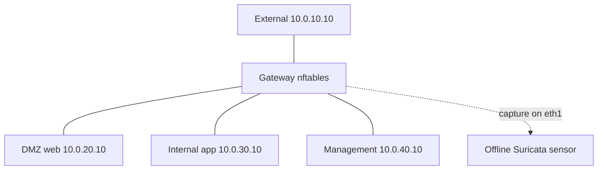

# Environment setup (instructor)

Use a disposable Ubuntu 24.04 LTS Linux VM, recommended 4 vCPU/8 GB/40 GB (minimum 2/4/25). Install dependencies while connected; disconnect external NIC before experiments. On ARM laptops use a compatible Linux VM or centrally hosted x86 Linux. Run commands from repository root. Mininet uses separate namespaces and direct virtual Ethernet links; no physical interfaces are attached.

```sh
bash environment/install.sh
bash environment/make-certs.sh
sudo python3 environment/topology.py
```

Zeek must be installed separately if not available in your distribution: follow https://docs.zeek.org/en/current/install.html and verify `zeek --version`. The offline Python exercises require only Python 3; plotting is optional. Record package versions and pin the VM snapshot used by the class. `work/` contains generated files and is ignored by Git.

## Topology and CLI



Each gateway interface eth0..eth3 has address 10.0.X.1/24 for X=10,20,30,40. Hosts have default routes via gateway. DNS uses a dedicated dnsmasq instance on the gateway, accessible from clients during Labs 01/02; HTTPS clients can use curl `--resolve web.lab.test:443:10.0.20.10` after firewall enforcement. The gateway input chain is outside Lab 03 scope. Actual TCP test listeners on port 22 are **not SSH servers**; they check reachability only. Nginx serves real HTTP/HTTPS. No NAT or public routing. No management access outside the isolated VM.

Mininet CLI examples (prefix commands with node name):

```text
ext curl --resolve web.lab.test:80:10.0.20.10 http://web.lab.test/
ext curl --resolve web.lab.test:443:10.0.20.10 --cacert work/lab-ca.crt https://web.lab.test/
ext dig @10.0.10.1 web.lab.test
r1 ip route
r1 tcpdump -ni eth0 -w work/live.pcap &
ext curl http://10.0.20.10/
r1 pkill -INT -x tcpdump
exit
```

Use a dedicated capture interface (eth0 before firewall, eth1 after). The CLI shares filesystem, not network namespaces. Stop captures before reading PCAPs. For other tools use a normal VM shell on saved PCAPs. On exit topology stops its services; if interrupted use `sudo mn -c` inside VM, not host. Never run global nftables commands on host.

## Smoke test

Verify all node routes, DNS response, authenticated HTTPS, listening test ports (`web ss -ltn`, `app ss -ltn`, `admin ss -ltn`), baseline connectivity, then apply Lab 03 rules and verify the matrix. Verify Suricata with supplied PCAPs before class. If the VM cannot support live topology, Labs 01 and 05 can use offline datasets; Labs 02 and 03 require instructor-provided equivalent environment for full credit.
